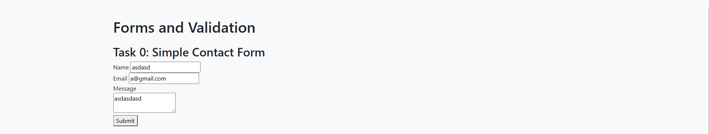
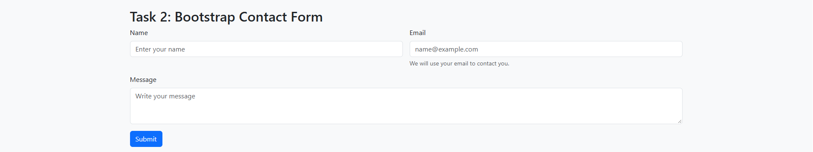
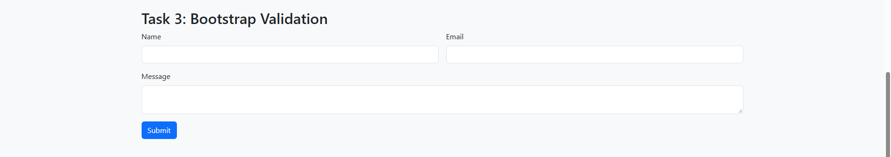
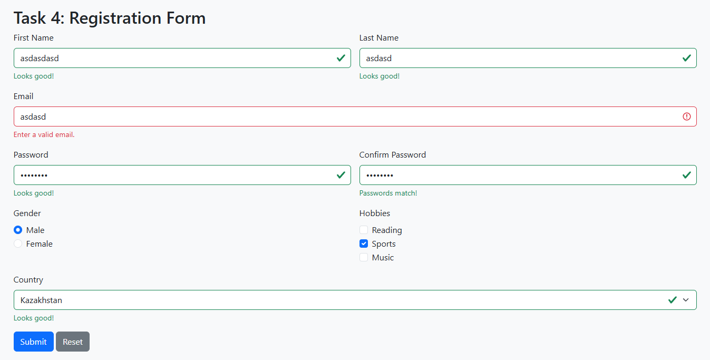

# Assignment 4: Forms and Validation

**Name:** Almanzor Kamzeyev 
**Group:** SE-2540

## Task 0: Simple Contact Form
Created a contact form with name, email, message, submit button, and labels.

## Task 1: HTML5 Validation
Added required fields, email validation, and maximum input lengths.

## Task 2: Bootstrap Form Styling
Styled the contact form using Bootstrap form controls, grid, placeholders, and helper text.

## Task 3: Bootstrap Validation Styles
Added valid and invalid feedback messages for the contact form.

## Task 4: Registration Form
Created a responsive registration form with names, email, passwords, gender, hobbies, country, submit and reset buttons, and validation feedback.

## Work Process
Built the basic HTML form, added HTML5 validation, applied Bootstrap styling, and added validation feedback. Then created the responsive registration form and tested required fields, email formatting, password length, and matching passwords.
